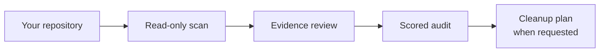

<div align="center">

# woekel works

**Less manual checking. Fewer loose ends. More room for the work that matters.**

Reusable Claude Code and Codex skills I build and run to make operations feel
lighter and reduce the need to remember every next step.

[](LICENSE)
[](https://www.python.org/)
[](skills/repo-structure-audit/tests/)

</div>

## Skills

[**Repo Structure Audit**](skills/repo-structure-audit/). Use it
when a repository feels hard to navigate, full of duplicates, or risky to reorganize.
It reads your repo, scores it against ten principles, and proposes the safest
cleanup. It never moves or deletes anything.

[**Review Critically**](skills/review-critically/). Use it when a plan, document,
design, or workflow needs a skeptical second opinion. It reconstructs the real
problem, separates evidence from inference, checks relevant external guidance, and
ranks the gaps that matter. It stays read-only unless you separately request changes.

**Court and co-parenting skills.** Seven skills for a parent in a custody or
co-parenting case. Everything is saved as plain files in one court folder you choose,
drafts only, and nothing is ever sent.

- [**Source Map**](skills/source-map/). Inventories every source of records, works through
  them in batches that can resume, and says plainly what's missing.
- [**Incident Log**](skills/incident-log/). Logs an incident or a message from the other
  parent as a dated evidence entry.
- [**Timeline Builder**](skills/timeline-builder/). Builds one sourced timeline, tags what
  matters, and lists contradictions and gaps.
- [**Narrative Writer**](skills/narrative-writer/). Drafts a calm, child-focused, cited
  narrative for a custody evaluator or attorney.
- [**Co-Parent Reply**](skills/co-parent-reply/). Drafts brief, firm replies to the other
  parent using the BIFF method.
- [**Attorney Packet**](skills/attorney-packet/). Prepares one-page attorney updates, keeps
  an attorney log, and drafts motion-prep packets.
- [**Proof Check**](skills/proof-check/). Checks a narrative or packet for citations that lead
  nowhere and claims the sources don't support, and lists them as questions.

Adapted with credit from [Case Forge](https://github.com/CaseForgeHq/family-court-strategist)
(MIT) and Anthropic's [claude-for-legal](https://github.com/anthropics/claude-for-legal)
chronology skill (Apache-2.0). Organized drafts for an attorney to review, not legal advice.

## Mods

[**Share Shield**](mods/share-shield/). Use it when you share your screen or
record it with Claude Code open. It notices Zoom sharing, macOS screen recording
and OBS, then blurs keys, passwords, emails, phone numbers and card numbers in
the chat until sharing ends.

```
/plugin install share-shield --marketplace kwoekel/woekel-works
```

[**Tidy**](mods/tidy/). Use it when your prompt is a messy brain dump. Click Tidy
above the prompt box, or type `/tidy`, and it rewrites the dump as clear
instructions (goal, steps, things to keep in mind, finished when, still unclear)
in the prompt box. You read it, edit it, then send it.

```
/plugin install tidy --marketplace kwoekel/woekel-works
```

## The structure audit model

To get value from the audit, you need its way of thinking. Here is the whole model in
four ideas.

### 1. Every fact has exactly one home

A fact is anything that can be true or false: a rule, a setting, a status, a decision.
It lives in one file. Every other file links there instead of repeating it. If you
must edit two files to keep one statement true, that statement has two homes, and one
of them is already drifting.

### 2. Files have jobs, not just types

| Kind | Job | Holds facts? | Examples |
|---|---|---|---|
| **Owner** | States a fact and keeps it correct | Yes | `STATUS.md`, `config.json`, code |
| **Router** | Points an agent to the right owner | No, only paths | `AGENTS.md`, `CLAUDE.md` |
| **Orientation** | Explains the repo to a person | Summary only | `README.md` |

Routers hold zero facts. A README is never a router and never the source of truth.

### 3. Ask five questions before placing anything

Who owns it? What job does it do? Who reads it? What authority does it have? What
lifecycle is it in? The answers decide the folder. The root is a map, not a drawer.

### 4. Active, generated, historical, and disposable must look different

If a machine can rebuild it, ignore it or mark it. If it was replaced, say so and keep
it findable. If it stopped being maintained, say that too. Cleanup should never be a
guess.

The audit turns these four ideas into ten scored principles, grouped as Navigability,
Ownership, Lifecycle, and Hygiene. The full lesson, the principle table, and what the
report looks like are in the
[skill README](skills/repo-structure-audit/README.md).

## How it works



The scanner collects facts. The skill checks those facts against your repo's actual
purpose and conventions before it recommends anything. A notes-only repo is never
told to add `src/` and `tests/`.

## Install

Clone this repository, then copy the skill you want into the tool you use:

```bash
git clone https://github.com/kwoekel/woekel-works.git

# Claude Code (replace <skill-name> with any folder name in skills/)
cp -R woekel-works/skills/<skill-name> ~/.claude/skills/

# Codex
cp -R woekel-works/skills/<skill-name> ~/.codex/skills/
```

Second-brain users: copy skills to `My-Second-Brain/.my-kit/skills/` instead, so they are
backed up with the brain, then ask your AI to relink skills.

Then ask in plain words: "Audit this repository's structure" or "Review this
plan critically."

Git is needed to clone the repository. Repo Structure Audit and Proof Check also need
Python 3; their scripts use only the standard library. Review Critically has no extra runtime
dependencies.

## Why I built it

Good operations should make work easier to carry, not add another system to
remember. I build these tools for my own operating system first, then share the
parts that can help someone else work with less friction.

I'm Kierra Woekel. I bring 10+ years across marketing operations, strategic
partnerships, and community engagement to AI systems built for real business
operations.

## License

MIT — use it, adapt it, and ship what helps.
